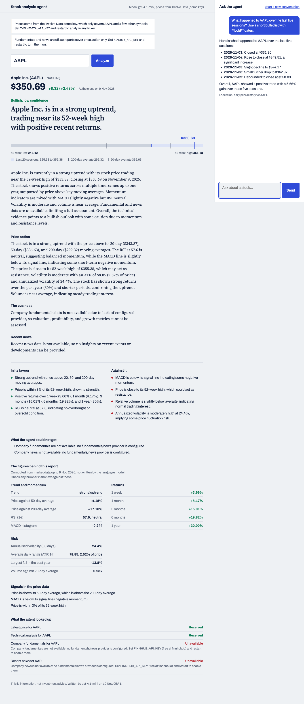

# Stock analysis agent

A tool-calling agent built with Spring AI 2.0 on Spring Boot 4.1 (Java 25). The language model
decides which data to look up and writes the interpretation; every number is fetched and computed
in Java, and each report carries the exact data it was based on.

## Run it

```sh
export OPENAI_API_KEY=...          # required
export TWELVEDATA_API_KEY=...      # optional: free key from twelvedata.com
export FINNHUB_API_KEY=...         # optional: free key from finnhub.io
mvn spring-boot:run
```

Open http://localhost:8090.



| Variable | Without it |
| --- | --- |
| `TWELVEDATA_API_KEY` | Uses Twelve Data's public `demo` key, which only answers for AAPL and a few other symbols |
| `FINNHUB_API_KEY` | Fundamentals and news are off; reports cover price action only and say so |
| `OPENAI_MODEL` | Defaults to `gpt-4.1-mini` |
| `PORT` | Defaults to 8090 |

## API

| Request | Returns |
| --- | --- |
| `GET /api/analysis/{symbol}` | Structured report (outlook, confidence, views, strengths, risks, data gaps) plus the tool results behind it |
| `POST /api/chat` with `{"message": "...", "conversationId": "..."}` | Free-form answer; reuse the returned `conversationId` for follow-ups |
| `GET /api/stocks/{symbol}/quote`, `/technicals`, `/fundamentals`, `/news?days=7` | The same data the tools see, without the model |
| `GET /api/status` | Model and data sources in use |

Errors are `application/problem+json` with a `kind` field: 400 invalid symbol, 404 unknown symbol,
429 provider rate limit, 502 provider or model failure, 503 provider not configured.

## How it is put together

- `marketdata` - provider interfaces, a Twelve Data client (quotes, daily bars), a Finnhub client
  (fundamentals, news), and `MarketDataService`, which validates tickers and caches results briefly
  to save free-tier credits.
- `analysis` - `Indicators` (SMA, EMA, RSI, MACD, Bollinger, ATR, volatility, drawdown) and
  `TechnicalAnalyzer`, which turns daily bars into a snapshot with plain-English signals and caveats.
- `agent` - `StockTools` (five `@Tool` methods), `StockAnalysisAgent` (ChatClient, chat memory,
  schema-enforced `StockReport`), and `ToolCallLog`, which records what each tool returned.
- `web` - REST controllers, error mapping, and a single static page in `resources/static`.

Tools never throw at the model: a failed lookup comes back as an explanation, so the model reports
the gap instead of inventing a figure.

## Tests

```sh
mvn test
```

147 tests, all offline. Indicator values are checked against an independent Python implementation;
the Twelve Data fixtures are real captured responses; the agent tests drive Spring AI's real
tool-calling loop with a scripted model. The Finnhub fixtures are hand-written from Finnhub's
published API spec and have not been checked against a live key.

## Limits

- Free tiers: Twelve Data allows 8 requests a minute; Finnhub covers US-listed companies.
- Conversation memory is in-process and is lost on restart.
- A data request whose connection drops before any response is retried once; error responses
  (rate limits, unknown symbols) are never retried.
- The latest session's volume is often incomplete until the provider publishes the final figure;
  the analyzer detects this and falls back to the previous session.
- This is information, not investment advice.
